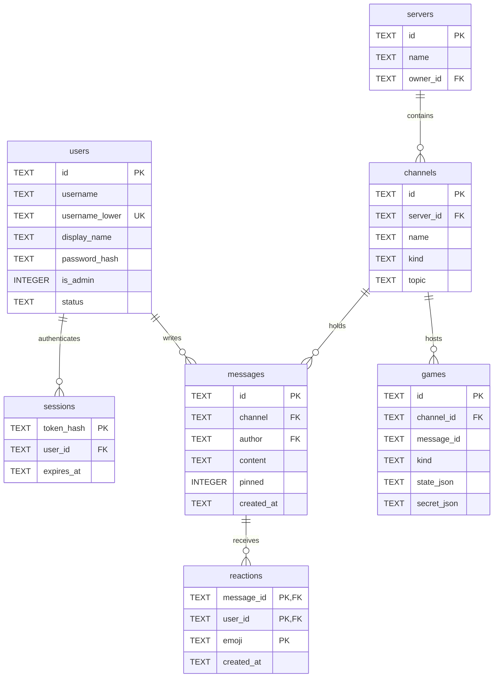

# Hoffle Codebase & Architecture Guide

This document is the technical reference for developers working on Hoffle. It covers the system architecture, runtime constraints, data models, real-time protocols, media pipelines, Discord bot compatibility, and step-by-step recipes for adding new features.

---

## Architecture at a Glance

Hoffle is a self-hosted voice, video, and chat server built on Cloudflare Workers, Next.js App Router (via Vinext and Vite), Cloudflare D1 (SQLite), and Cloudflare Durable Objects.

```
                         Browser / Mobile / Desktop Clients
                                        │
                    ┌───────────────────┴───────────────────┐
                    │ HTTP (Pages, REST, Assets)            │ WebSocket (/api/realtime, /api/gateway)
                    ▼                                       ▼
 ┌──────────────────────────────────────┐     ┌──────────────────────────────────────┐
 │       Cloudflare Worker Host         │     │           Durable Objects            │
 │         (worker/index.ts)            │     │                                      │
 │                                      │     │ • HuddleHub (lib/hub.ts)             │
 │ • Vinext App Router handler          │     │   WebSockets, presence, voice mesh   │
 │ • Discord REST v10 (lib/discord/rest)│     │   signaling, stage roles, music sync │
 │ • Discord CDN (lib/discord/cdn)      │     │ • DiscordGateway (discord/gateway.ts)│
 │ • Security headers & rate limits     │     │   Discord v10 gateway protocol       │
 └──────────────────┬───────────────────┘     └──────────────────┬───────────────────┘
                    │                                            │
                    ▼                                            ▼
 ┌──────────────────────────────────────┐     ┌──────────────────────────────────────┐
 │            Storage Layer             │     │          Auxiliary Services          │
 │                                      │     │                                      │
 │ • Cloudflare D1 (SQLite database)    │     │ • music-bot (yt-dlp + ffmpeg daemon) │
 │ • Cloudflare R2 / Local Disk uploads │     │ • livekit (optional SFU server)      │
 │ • Durable Object SQLite storage      │     │ • recorder-service (session capture) │
 └──────────────────────────────────────┘     └──────────────────────────────────────┘
```

### Runtime Environment & Invariants

1. **Edge Worker Runtime**: Code in `worker/` and `lib/` runs in Cloudflare Workers V8 isolates (`nodejs_compat`). Node native C++ bindings (e.g. `bcrypt`, raw `net.Socket`) do not exist. Crypto uses standard `WebCrypto` (`crypto.subtle`).
2. **Vinext Framework**: `vinext` runs Next.js App Router conventions on top of Vite and Workers. Page components and API route handlers (`app/api/**/route.ts`) compile into the worker bundle.
3. **Persistent SQLite (`state/`)**: In Docker and local development, Wrangler runs with `--persist-to state`. D1 SQLite data and local upload files live in `./state`. Backing up that folder backs up the entire server.
4. **WebSocket Interception**: WebSocket handshakes (`/api/realtime` and `/api/gateway`) are intercepted in `worker/index.ts` **before** Vinext handles the request. Vinext appends headers like `Vary` to responses; attempting to set headers on a 101 Switching Protocols response throws an uncatchable runtime exception in Workers.

---

## Directory Index

```
huddle/
├── app/                          # Next.js App Router (Frontend + API endpoints)
│   ├── admin/                    # Instance admin & growth analytics dashboard
│   ├── api/                      # Backend REST API routes
│   │   ├── (features)/           # Feature APIs (music, watch, feeds, webhooks, events, battlemap, polls, games, tts, stt, unfurl)
│   │   ├── admin/                # Admin management, media inspection, growth metrics
│   │   ├── auth/                 # Signup, guest join, login, passkeys, session, password reset
│   │   ├── channels/             # Channel CRUD, permissions, reads, ordering, topics
│   │   ├── dms/                  # Direct message conversations and group DMs
│   │   ├── invites/              # Server invite creation, validation & previews
│   │   ├── messages/             # Message posting, search, reactions, pins, edits, forwards
│   │   ├── push/                 # Web Push & native FCM mobile push
│   │   ├── servers/              # Server management, roles, members, folders, templates
│   │   ├── settings/             # User profile, appearance, UI mode, security & data export
│   │   ├── uploads/              # Standard & 2 GB temporary big-file R2 uploads
│   │   ├── v1/                   # Hoffle native HTTP + SSE bot API
│   │   └── voice/                # Voice tokens, ICE/TURN servers, mute/move/disconnect
│   ├── components/               # React UI components
│   │   ├── chat/                 # Modular chat shell (app/components/chat/shell/), rail, voice bar
│   │   ├── server-settings/      # Server settings tabs (roles, safety, integrations, feeds, webhooks, audit log)
│   │   ├── settings/             # User settings tabs (appearance, style studio, voice, passkeys, simple mode)
│   │   ├── voice-stage/          # Voice stage, tiles, soundboard drawer & bottom bar
│   │   ├── widgets/              # Customizable toolbar & pinnable bot/music widgets
│   │   ├── battlemap.tsx         # Shared tabletop canvas with tokens & fog
│   │   ├── club-scene.ts         # Beat-synced 3D nightclub venue & lighting rig
│   │   ├── club-skins.ts         # Theme-specific 3D club skins (Winamp, Star Wars, Matrix, Minecraft)
│   │   ├── dice-overlay.tsx      # 3D Three.js + Cannon-es physics dice roller
│   │   ├── living-room.tsx       # Shared 3D Living Room (Library, Cinema, Tabletop, Club)
│   │   ├── msn-chrome.tsx        # Retro MSN Messenger window chrome & controls
│   │   └── retro-chrome.tsx      # Winamp & retro desktop skin chrome + 10-band EQ
│   ├── hooks/                    # Reusable React hooks
│   │   ├── chat-shell/           # 9-stage modular hook pipeline powering ChatShell
│   │   ├── use-hub.ts            # Primary WebSocket connection to HuddleHub
│   │   ├── use-living-room.ts    # 3D Living Room & Club real-time synchronization
│   │   ├── use-voice.ts          # WebRTC peer mesh & LiveKit SFU room handling
│   │   └── use-player.ts         # Synced music player clock & controls
│   ├── lib/                      # Frontend-only utility modules
│   │   ├── chat/                 # Slash command runners (lookup, music, watch, record, roll) & helpers
│   │   ├── tts/                  # Browser ONNX/Piper text-to-speech worker & client
│   │   ├── club-lights.ts        # Beat/bar/section lighting choreographer
│   │   ├── commands.ts           # Slash command registry & aliases
│   │   ├── devices.ts            # Audio/video device enumeration & hot-swap
│   │   ├── docs.ts               # Markdown-to-HTML renderer for hoffle.online/docs
│   │   ├── mic-chain.ts          # Web Audio & AudioWorklet microphone DSP chain
│   │   ├── spatial-audio.ts      # 3D Web Audio HRTF panner positioning
│   │   ├── voice-bitrate.ts      # Dynamic mesh uplink bitrate budgeting
│   │   ├── voice-effects.ts      # Real-time vocal effects (Singing pitch-tune, Vampire, Gramophone)
│   │   └── voice-mesh.ts         # WebRTC peer connection mesh state machine
│   ├── chat-shell.tsx            # Root chat client entry orchestrating useShell* hooks
│   ├── globals.css               # Core theme tokens, CSS variables, layout styles
│   └── layout.tsx                # HTML shell, fonts, metadata
├── lib/                          # Core backend business logic and shared models
│   ├── discord/                  # Discord API v10 compatibility layer
│   │   ├── gateway.ts            # DiscordGateway Durable Object (WebSocket)
│   │   ├── rest.ts               # Discord v10 REST endpoints
│   │   ├── interactions.ts       # Slash command, button, select & modal interactions
│   │   ├── cdn.ts                # Discord-compatible avatar/attachment CDN endpoints
│   │   ├── snowflake.ts          # 64-bit Twitter Snowflake generator & parser
│   │   └── serialize.ts          # Entity mapping between Hoffle and Discord
│   ├── i18n-catalog/             # English (en) and Turkish (tr) translation catalogs
│   ├── auth.ts                   # Passwords (PBKDF2-SHA256), sessions, guest accounts, cookies
│   ├── automod.ts                # Keyword, link, spam, caps, and repeat filters
│   ├── club-desk.ts & club-feed.ts # Club DJ lighting desk & real-time audio frame encoding
│   ├── feeds.ts                  # RSS, Atom, YouTube, Reddit, Bluesky, Mastodon & GitHub feed poller
│   ├── games.ts                  # Pure state reducers for in-chat games
│   ├── hub.ts                    # HuddleHub Durable Object implementation
│   ├── permissions.ts & channel-permissions.ts # Bitwise role and per-channel permission overwrites
│   ├── protocol.ts               # Wire types for client/server WebSocket frames
│   ├── schema.ts                 # D1 SQLite schema (v23), idempotent migrations, seed channels
│   ├── search-query.ts           # Search operators tokenizer and SQL compiler
│   ├── themes.ts                 # Theme palettes, custom CSS engine, serializer
│   └── webhooks.ts               # Incoming webhooks (Discord, Slack, GitHub, GitLab, Gitea/Forgejo)
├── worker/
│   └── index.ts                  # Worker fetch entry point, WebSocket dispatcher & security headers
├── desktop/                      # Electron desktop client (Windows, macOS, Linux)
├── desktop-tauri/                # Hoffle Lite (Rust + Tauri v2 desktop client)
├── desktop-native-macos/         # Native macOS Cocoa / WebKit client (Apple Silicon)
├── desktop-native-windows/       # Native Windows C++17 / Win32 / WebView2 client
├── desktop-native-linux/         # Native Linux C++17 / GTK3 / WebKit2GTK client
├── native-qt/                    # Experimental C++17 / Qt6 native client
├── mobile/                       # Capacitor mobile app for Android and iOS
├── services/                     # Companion Docker services (music-bot, dnd-bot, musicwatch, party-bot)
├── discord-bridge/               # Bi-directional Discord channel mirror
├── recorder-service/             # Multi-track audio/video session recorder daemon
├── deploy/                       # Nginx configs, systemd units, Coturn TURN, healthchecks, Unraid XML
├── scripts/                      # Zero-downtime deploy.sh, workerd-config.sh, admin.mjs, dj-analysis
└── test/                         # Vitest test suite (180+ files: unit, D1 SQLite, jsdom, axe-core a11y)
```

---

## Storage & Data Layer (`lib/schema.ts`)

### D1 Runtime Migrations

Database migrations in Hoffle are runtime-driven and self-applying:

- `ensureSchema(db: D1Database)` executes once per worker isolate startup.
- Every migration statement must be idempotent: `CREATE TABLE IF NOT EXISTS`, `CREATE INDEX IF NOT EXISTS`, and dynamic column detection via `PRAGMA table_info(<table>)`.
- The current version is tracked in the `meta` table under the key `schema_version`. The current schema version is `23`.
- If an isolate crashes during migration, the cached promise in `ensureSchema` is cleared so subsequent requests can re-attempt migration instead of remaining poisoned.

### Core Tables & Invariants

| Table | Primary Key | Description & Constraints |
| :--- | :--- | :--- |
| `users` | `id` (UUID) | Stores credentials, profile data, and settings. Passwords hashed using PBKDF2-SHA256 with 150,000 iterations. Unique index on `username_lower`. |
| `sessions` | `token_hash` | Active user sessions. Stores the SHA-256 hash of the random session token sent in the `hoffle_session` cookie (90-day TTL). Leaked database dumps cannot be used to forge sessions. |
| `servers` | `id` (TEXT) | Community servers. The default primary server has id `"hangout"`. |
| `channels` | `id` (TEXT) | Channels for text, voice, announcement, forum, and stage. Direct messages (DMs) also live in this table with the sentinel `server_id = 'dm'` so all message querying logic remains identical. |
| `messages` | `id` (UUID) | Chat messages. Columns include `channel`, `author`, `content`, `attachment_key`, `is_bot`, `reply_to_id`, `pinned`, `edited_at`. |
| `reactions` | `(message_id, user_id, emoji)` | Emoji reactions. Primary key composite prevents duplicate reactions by the same user on a single message. |
| `roles` & `member_roles` | `id` / composite | Role definitions and user assignments. Roles contain bitwise 64-bit permission integers (`permissions.ts`) and optional hex colors. |
| `games` | `id` (UUID) | In-chat game sessions. Stores public `state_json` and server-only `secret_json` (e.g. minesweeper bomb coordinates or hidden rock-paper-scissors throws). |
| `automod_rules` | `id` (UUID) | Per-server automated moderation rules (keyword triggers, link blocks, mention spam thresholds). |
| `push_subscriptions` | `endpoint` | Registered WebPush browser keys and native mobile FCM registration tokens. |

### Database Schema Diagram



---

## Real-Time Architecture & Durable Objects

Hoffle uses two Cloudflare Durable Objects to manage all persistent WebSocket connections.

### 1. `HuddleHub` (`lib/hub.ts`)

`HuddleHub` is a singleton Durable Object that holds all active client WebSockets for real-time chat, presence, voice signaling, and room state.

#### Hibernation and Keepalive
- `this.ctx.setWebSocketAutoResponse(...)` configures the Cloudflare runtime to answer client WebSocket `ping` frames automatically in C++. Idle clients stay connected without waking the V8 JavaScript isolate.
- When an active message arrives, the isolate wakes and parses incoming payloads in `webSocketMessage(ws, message)`.

#### Attachment State
Each active socket has an attachment deserialized into memory:
```typescript
interface Attachment {
  connectionId: string;    // Unique per-tab connection ID
  userId: string;          // User account ID
  channelId: string | null;// Currently subscribed text channel
  voiceChannelId: string | null; // Joined voice room
  muted: boolean;          // Local mic muted
  deafened: boolean;       // Local sound muted
  handRaised?: boolean;    // Stage channel hand-raise
  speakAllowed?: boolean;  // Stage channel speaker permission
  invisible?: boolean;     // Hidden from presence lists
}
```

#### Shared Music Player Synchronization
The music player position is calculated authoritatively on the server to prevent desync:
```typescript
export function playbackPosition(state: PlayerState, now = Date.now()): number {
  if (!state.track) return 0;
  if (state.paused) return state.positionMs;
  return state.positionMs + Math.max(0, now - state.updatedAt);
}
```
Listeners compute elapsed time relative to `updatedAt` without requiring high-frequency tick broadcasts.

### 2. `DiscordGateway` (`lib/discord/gateway.ts`)

This Durable Object emulates Discord's Gateway v10 WebSocket protocol. When a bot connecting with `discord.js` or `discord.py` connects to `/api/gateway`:
- The gateway sends `OpCode 10 (HELLO)` with `heartbeat_interval` (~41,250 ms).
- The bot replies with `OpCode 2 (IDENTIFY)` containing its bot token.
- The gateway validates the token, marks the bot online, and dispatches `OpCode 0 (DISPATCH)` events: `READY`, `GUILD_CREATE`, `MESSAGE_CREATE`, `INTERACTION_CREATE`, etc.

### Protocol Wire Types (`lib/protocol.ts`)

#### Client to Server (`ClientEvent`)
- `subscribe`: `{ t: "subscribe", channelId: string }`
- `voice-join`: `{ t: "voice-join", channelId: string }`
- `voice-leave`: `{ t: "voice-leave" }`
- `voice-state`: `{ t: "voice-state", muted?, deafened?, handRaised?, ... }`
- `signal`: `{ t: "signal", to: string, data: unknown }` (WebRTC SDP/ICE addressed to specific `connectionId`)
- `stage-speaker`: `{ t: "stage-speaker", connectionId: string, allowed: boolean }`
- `player`: `{ t: "player", channelId: string, action: PlayerAction }`
- `typing`: `{ t: "typing", channelId: string }`

#### Server to Client (`ServerEvent`)
- `presence`: `{ t: "presence", online: string[], serverNow: number }`
- `message`: `{ t: "message", channelId: string, message: Message, serverNow: number }`
- `voice`: `{ t: "voice", channelId: string, participants: VoiceParticipant[], serverNow: number }`
- `signal`: `{ t: "signal", from: string, data: unknown, serverNow: number }`
- `reaction`: `{ t: "reaction", channelId: string, messageId: string, emoji: string, userId: string, added: boolean }`
- `player`: `{ t: "player", state: PlayerState, serverNow: number }`
- `dice-roll`: `{ t: "dice-roll", channelId: string, roll: DiceRollEvent, serverNow: number }`
- `battlemap`: `{ t: "battlemap", channelId: string, action: string, token?, stroke?, ... }`

---

## Voice, Audio & Media Pipeline

Voice in Hoffle combines client-side DSP, WebRTC peer mesh, optional LiveKit SFU routing, and a 3D spatial audio engine.

```
 [Microphone Stream]
         │
         ▼
 [Web AudioContext]
         │
         ▼
 [AudioWorklet (public/mic-worklet.js)]
   ├─ 80Hz High-pass Filter (Kills low rumble & desk vibrations)
   ├─ RNNoise Wasm (Neural steady-noise suppression: fans, keyboards)
   ├─ Voice Focus Gate (Suppresses background voices 12dB below speaker peak)
   ├─ Automatic Gain Control (AGC with soft limiter)
   └─ Voice Activity Detection (VAD with hysteresis)
         │
         ▼
 [WebRTC PeerConnection / LiveKit SFU]
         │
         ▼ (Encrypted network transport)
         │
 [Remote Participant Audio Stream]
         │
         ▼
 [Spatial Audio Engine (app/lib/spatial-audio.ts)]
   ├─ Coordinate mapper (Voice room circle positions)
   ├─ Web Audio PannerNode (HRTF model for binaural 3D space)
   └─ Optional Head-Tracking (Webcam face tracker or manual controls)
         │
         ▼
 [Headphones / Speakers]
```

### Critical Voice Gotchas

1. **AudioWorklet & WebAssembly Isolation**:
   The audio worklet runs in a separate thread/realm. You **cannot** pass a compiled `WebAssembly.Module` object via `postMessage` across that boundary in modern browsers—it is silently dropped. `app/lib/mic-chain.ts` fetches raw Wasm bytes (`/rnnoise.wasm`), transfers the `ArrayBuffer`, and compiles Wasm synchronously inside the worklet scope.
2. **Mesh vs SFU Switching**:
   - By default, voice calls are peer-to-peer WebRTC meshes. Signaling is handled via `HuddleHub`.
   - When rooms grow or LiveKit is configured, `app/hooks/use-voice.ts` requests a token from `/api/voice/token` and attaches tracks to a LiveKit SFU room.
3. **Spatial Positioning Math**:
   In `app/lib/spatial-audio.ts`, participant audio nodes are positioned along a horizontal unit circle. The listener sits at $(0, 0, 0)$. Participant $i$ of $N$ is placed at:
   $$x = \sin\left(\frac{2\pi i}{N}\right), \quad y = 0, \quad z = -\cos\left(\frac{2\pi i}{N}\right)$$
   This produces natural left/right/front separation in stereo headphones using Web Audio's `HRTF` panning model.

---

## Discord Bot Compatibility (`lib/discord/`)

Hoffle implements Discord's v10 API so bots written in `discord.js` or `discord.py` work without code modifications.

### Architecture
- **Snowflakes (`lib/discord/snowflake.ts`)**: Generates 64-bit integer IDs formatted identically to Discord:
  $$\text{Snowflake} = ((\text{timestamp} - 1420070400000) \ll 22) \mid \text{workerId}$$
- **REST Endpoints (`lib/discord/rest.ts`)**: Implements:
  - `/api/v10/users/@me`
  - `/api/v10/guilds/{guild_id}`
  - `/api/v10/guilds/{guild_id}/channels`
  - `/api/v10/channels/{channel_id}/messages`
  - `/api/v10/channels/{channel_id}/messages/{message_id}/reactions/{emoji}`
  - `/api/v10/interactions/{id}/{token}/callback`
- **Component & Embed Support**: Handles Rich Embeds, Action Rows, Interactive Buttons, and Select Menus.

---

## Retro & MSN Subsystems

Hoffle includes an authentic reproduction of MSN Messenger (Windows Live Messenger 7.5):

- **Window Chrome (`app/components/msn-chrome.tsx`)**: Recreates the classic blue gradient frame, status selectors, sound toggles, and contact lists.
- **Nudges & Shakes**: Triggers window shake animations (`globals.css` keyframes) and plays the classic `nudge.mp3` audio cue.
- **Winks (`app/lib/msn-winks.ts`)**: Canvas-rendered full-screen vector animations:
  - Knocking on screen (`knock`)
  - Water balloon splash (`water-balloon`)
  - Kiss lips imprint (`kiss`)
  - Laughing boy (`laugh`)
  - Ghost haunting (`ghost`)
  - Birthday cake candles (`birthday`)
  - Heart balloon pop (`heart`)
  - Boxing glove strike (`boxer`)
- **Emoticons (`lib/msn-emoticons.ts`)**: Automatically converts classic ASCII smileys (`:)`, `:-D`, `(L)`, `(M)`, `(H)`) into retro animated assets.

---

## In-Chat Games (`lib/games.ts` & `lib/rota.ts`)

Conversation games run entirely inside message cards with pure state machines:

1. **Tic-Tac-Toe (`tictactoe`)**: 3x3 grid with win-line validation.
2. **Connect 4 (`connect4`)**: 7-column x 6-row grid with gravity simulation and 4-in-a-row diagonal/orthogonal checkers.
3. **Rock Paper Scissors (`rps`)**: Simultaneous hidden move submissions revealed simultaneously when both players throw.
4. **Minesweeper Flags (`mines`)**: MSN Messenger classic. 16x16 grid with 51 hidden mines. Uncovering safe cells passes the turn; uncovering a mine awards a point and another turn. First to 26 wins.
5. **Rota (`rota`)**: Geography route connection game. Players take turns naming bordering countries to link a start country to an end country. Evaluated against a shortest-path BFS graph (`ROTA_COUNTRIES`). Supports English and Turkish aliases.

---

## Feature Implementation Cookbooks

### 1. Adding a New API Route

Create `app/api/<feature>/route.ts`. All endpoints must authenticate the user, validate request payloads, check rate limits, and catch database failures:

```typescript
// app/api/notes/route.ts
import { currentUser } from "@/lib/auth";
import { bindings } from "@/lib/storage";
import { checkRateLimit } from "@/lib/rate-limit";

export async function GET(request: Request) {
  const user = await currentUser(request);
  if (!user) {
    return Response.json({ error: "Unauthorized" }, { status: 401 });
  }

  const { DB } = bindings();
  if (!DB) {
    return Response.json({ error: "Database unavailable" }, { status: 503 });
  }

  const notes = await DB.prepare(
    "SELECT id, content, created_at FROM notes WHERE user_id = ? ORDER BY created_at DESC LIMIT 50"
  ).bind(user.id).all();

  return Response.json({ notes: notes.results || [] });
}

export async function POST(request: Request) {
  const user = await currentUser(request);
  if (!user) {
    return Response.json({ error: "Unauthorized" }, { status: 401 });
  }

  // Rate limit: 10 note creations per 60 seconds
  const rateLimit = await checkRateLimit(request, `notes:${user.id}`, 10, 60);
  if (!rateLimit.allowed) {
    return Response.json({ error: "Rate limit exceeded" }, { status: 429 });
  }

  const body = await request.json().catch(() => null);
  const content = typeof body?.content === "string" ? body.content.trim() : "";
  if (!content || content.length > 500) {
    return Response.json({ error: "Note must be between 1 and 500 characters" }, { status: 400 });
  }

  const id = crypto.randomUUID();
  const now = new Date().toISOString();
  const { DB } = bindings();

  await DB.prepare(
    "INSERT INTO notes (id, user_id, content, created_at) VALUES (?, ?, ?, ?)"
  ).bind(id, user.id, content, now).run();

  return Response.json({ note: { id, content, created_at: now } }, { status: 201 });
}
```

---

### 2. Extending the Database Schema

To add a new table or column, edit `lib/schema.ts`:

1. Add your DDL statements inside `migrate(db: D1Database)`:
   ```typescript
   // lib/schema.ts (inside migrate function)
   await db.batch([
     db.prepare(`CREATE TABLE IF NOT EXISTS notes (
       id TEXT PRIMARY KEY,
       user_id TEXT NOT NULL,
       content TEXT NOT NULL,
       created_at TEXT NOT NULL
     )`),
     db.prepare("CREATE INDEX IF NOT EXISTS notes_user_time_idx ON notes(user_id, created_at)"),
   ]);
   ```
2. If adding a column to an existing table, verify column existence first:
   ```typescript
   const userCols = await columnNames(db, "users");
   if (!userCols.has("custom_badge")) {
     await db.prepare("ALTER TABLE users ADD COLUMN custom_badge TEXT").run();
   }
   ```
3. Increment `SCHEMA_VERSION` at the top of `lib/schema.ts`:
   ```typescript
   export const SCHEMA_VERSION = 24;
   ```

---

### 3. Adding a Real-Time WebSocket Event

1. **Register the Event in `lib/protocol.ts`**:
   ```typescript
   // ClientEvent union:
   | { t: "note-share"; noteId: string; channelId: string }

   // ServerEvent union:
   | { t: "note-share"; noteId: string; channelId: string; fromUser: string; serverNow: number }
   ```
2. **Handle the Event in `lib/hub.ts` (`HuddleHub`)**:
   ```typescript
   // Inside HuddleHub.webSocketMessage:
   case "note-share": {
     const sender = this.getAttachment(ws);
     this.broadcastToChannel(event.channelId, {
       t: "note-share",
       noteId: event.noteId,
       channelId: event.channelId,
       fromUser: sender.displayName,
       serverNow: Date.now(),
     });
     break;
   }
   ```
3. **Listen for the Event in `app/hooks/use-hub.ts`**:
   ```typescript
   case "note-share": {
     onNoteShare?.(event.noteId, event.fromUser);
     break;
   }
   ```

---

### 4. Adding a Slash Command

Register the command in `app/lib/commands.ts`:

```typescript
// app/lib/commands.ts
export const SLASH_COMMANDS: SlashCommand[] = [
  // ...
  {
    name: "rollstats",
    description: "Roll 4d6 dropping the lowest for standard D&D ability scores",
    group: "D&D",
  },
];
```

Execute the command in `app/hooks/chat-shell/use-shell-commands.ts` inside `runCommand(raw)`:

```typescript
if (name === "rollstats") {
  const rollStats = Array.from({ length: 6 }, () => {
    const dice = Array.from({ length: 4 }, () => Math.floor(Math.random() * 6) + 1);
    dice.sort((a, b) => a - b);
    return dice.slice(1).reduce((sum, d) => sum + d, 0);
  });
  await sendText(`Ability score rolls: **${rollStats.join(", ")}** (Total: ${rollStats.reduce((a, b) => a + b, 0)})`);
  return;
}
```

---

### 5. Writing and Running Tests

All automated tests use **Vitest**. Component tests run in a simulated DOM using `jsdom`, and accessibility checks use `axe-core`.

#### Commands
```bash
# Typecheck (tsc --noEmit)
npm run typecheck

# Run test suite
npm test

# Run CI checks (typecheck + test suite)
npm run verify
```

#### Writing a Component Test
```tsx
// @vitest-environment jsdom
import { render, screen, fireEvent } from "@testing-library/react";
import { describe, it, expect, vi } from "vitest";
import { NoteCard } from "@/app/components/note-card";

describe("NoteCard", () => {
  it("displays note content and calls delete handler", () => {
    const onDelete = vi.fn();
    render(<NoteCard id="123" content="Hello world" onDelete={onDelete} />);

    expect(screen.getByText("Hello world")).toBeDefined();
    fireEvent.click(screen.getByRole("button", { name: /delete/i }));
    expect(onDelete).toHaveBeenCalledWith("123");
  });
});
```

#### Accessibility (a11y) Tests
Use the helper in `test/a11y.ts` to assert that interactive components meet WCAG standards:
```tsx
// @vitest-environment jsdom
import { render } from "@testing-library/react";
import { describe, it } from "vitest";
import { assertAccessible } from "./a11y";
import { NoteDialog } from "@/app/components/note-dialog";

describe("NoteDialog a11y", () => {
  it("has no accessibility violations", async () => {
    const { container } = render(<NoteDialog open onOpenChange={() => {}} />);
    await assertAccessible(container);
  });
});
```

---

## Development & Operations Reference

### Common CLI Tasks

| Task | Command |
| :--- | :--- |
| **Start Dev Server** | `npm run dev` (starts Vinext on `http://localhost:3001`) |
| **Run Production Worker** | `npm run build && npm run serve` (runs local worker with SQLite on port `8730`) |
| **Run Admin CLI** | `npm run admin` (reset passwords, promote admins, generate emergency tokens) |
| **Test TURN Connectivity** | `npm run check:turn` (validates STUN/TURN ICE candidate generation) |
| **Inspect SQLite DB** | `sqlite3 state/v3/d1/miniflare-D1DatabaseObject/*.sqlite` |

### Administrative CLI Commands
```bash
# Promote an account to administrator
node scripts/admin.mjs promote <username>

# Reset a user's password
node scripts/admin.mjs password <username> <new-password>

# Create an invite link directly from CLI
node scripts/admin.mjs invite [channel-id]
```
